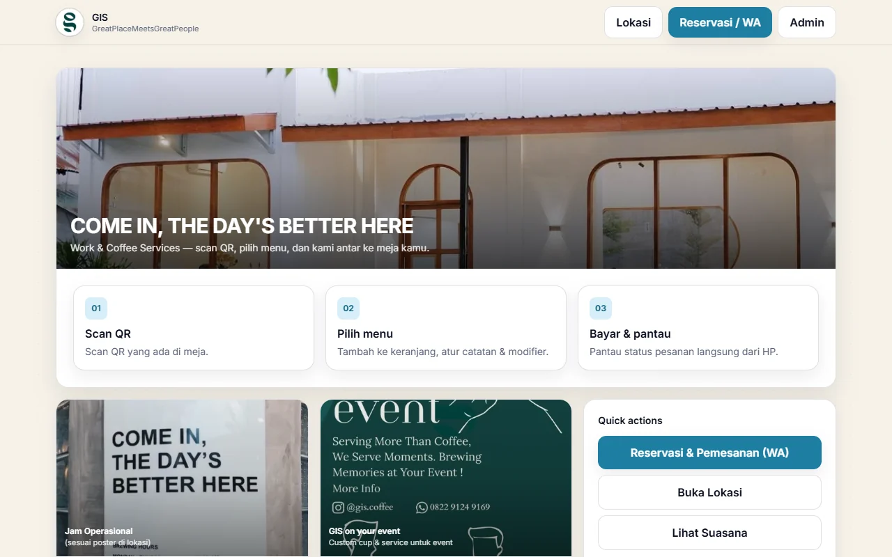

<table>
  <tr>
    <td width="46%" valign="top">
      <h2>GIS — Work &amp; Coffee Services</h2>
      <p>Sistem pemesanan QR per meja untuk <b>GIS Coffee</b> — dari pemilihan menu, keranjang &amp; catatan pesanan, pembayaran iPaymu, hingga pelacakan status dapur.</p>
      <p>
        <a href="https://giscafe.gimmhost.my.id/"></a>
      </p>
      <ul>
        <li><b>Table QR Token (<code>/t/{token}</code>)</b> — Otomatis mengenali nomor meja saat scan.</li>
        <li><b>Checkout &amp; Payment</b> — Pembayaran cashless terintegrasi webhook iPaymu.</li>
        <li><b>Admin &amp; Kitchen Panel</b> — Kelola meja/QR (<code>/admin/tables</code>) &amp; progres pesanan (<code>/admin/orders</code>).</li>
        <li><b>Verified Feedback</b> — Ulasan 1× per order setelah pesanan berstatus SELESAI.</li>
      </ul>
    </td>
    <td width="54%" valign="middle">
      
    </td>
  </tr>
</table>

<details>
<summary><b>Setup Lokal &amp; Konfigurasi iPaymu</b></summary>

```bash
composer install && npm install
cp .env.example .env && php artisan key:generate
php artisan migrate && php artisan db:seed
php artisan serve
```

Isi `IPAYMU_ENV`, `IPAYMU_VA`, `IPAYMU_API_KEY` di `.env`. Panel admin tersedia di `/admin/login`.

</details>
